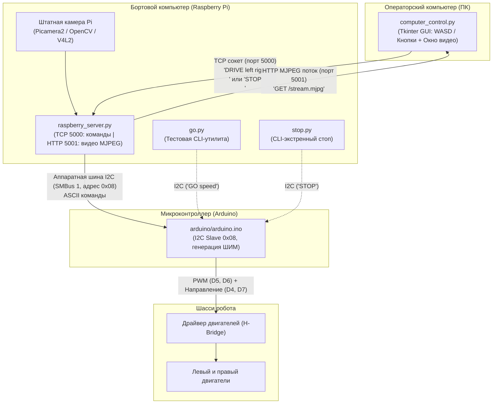

# Подробное описание проекта OmegaBot

Проект **OmegaBot** представляет собой программно-аппаратный комплекс для дистанционного управления колесным роботом с дифференциальным приводом. 

Система построена по трёхуровневой архитектуре:
1. **Клиентский уровень (Операторский ПК):** Графическое приложение на Python (Tkinter) для приема команд оператора с клавиатуры или экранных кнопок и отправки управляющих пакетов по сети TCP/IP.
2. **Серверный уровень (Raspberry Pi):** Промежуточный бортовой компьютер, принимающий сетевые команды по TCP/IP, валидирующий их и транслирующий в аппаратную шину I2C.
3. **Исполнительный уровень (Arduino):** Микроконтроллер, работающий как ведомое устройство (I2C Slave), принимающий команды с шины I2C и формирующий ШИМ (PWM) сигналы для драйвера двух моторов.

---

## 1. Архитектура системы и схема взаимодействия



---

## 2. Подробное описание компонентов проекта

### 2.1. `arduino/arduino.ino` — Прошивка микроконтроллера управления моторами

Файл содержит скетч для платы Arduino, отвечающий за низкоуровневое аппаратное управление двигателями через драйвер моторов по схеме «ШИМ + Направление».

* **Шина I2C:**
  * Arduino инициализируется как I2C Slave с адресом `0x08` (`Wire.begin(I2C_ADDRESS)`).
  * Назначен обработчик входящих сообщений `Wire.onReceive(receiveCommand)`.
* **Подключение моторов к выводам Arduino:**
  * **Левый мотор:** 
    * `LEFT_PWM = 6` — сигнал широтно-импульсной модуляции (скорость).
    * `LEFT_IN2 = 7` — дискретный сигнал направления вращения.
  * **Правый мотор:** 
    * `RIGHT_PWM = 5` — сигнал широтно-импульсной модуляции (скорость).
    * `RIGHT_IN2 = 4` — дискретный сигнал направления вращения.
* **Логика управления моторами (`setMotor`):**
  * `speed == 0`: Вывод направления переводится в `LOW`, ШИМ устанавливается в `0` (мотор обесточен).
  * `speed > 0` (вперед): Вывод направления переводится в `HIGH`, а на ШИМ подается инвертированное значение `255 - pwm`.
  * `speed < 0` (назад): Вывод направления переводится в `LOW`, а на ШИМ подается прямое значение `pwm`.
* **Масштабирование скорости (`setMotorsSpeed`):**
  * Входные значения скоростей принимаются в процентах от `-100` до `100`.
  * Функция пересчитывает проценты в диапазон 8-битного ШИМ Arduino: `pwm = abs(speed) * 255 / 100` (от `0` до `255`).
* **Парсинг команд (`receiveCommand`):**
  * Принимает поток байт из шины I2C и сохраняет их в буфер `command[32]`.
  * Поддерживает три команды:
    1. `STOP` — вызывает `stopMotors()`, мгновенно отключая оба мотора.
    2. `DRIVE <left> <right>` — считывает целочисленные скорости отдельно для левого и правого бортов (с проверкой диапазона `[-100; 100]`).
    3. `GO <speed>` — устанавливает одинаковую скорость для обоих моторов (движение по прямой).

---

### 2.2. `raspberry_server.py` — TCP/I2C сервер команд и HTTP MJPEG видеостример

Скрипт предназначен для постоянной работы на бортовом компьютере Raspberry Pi. Он выполняет две ключевые параллельные задачи:
1. Принимает команды движения по TCP-сокету и ретранслирует их на плату Arduino по аппаратной шине I2C.
2. Захватывает видеопоток со штатной камеры Raspberry Pi и транслирует его по отдельному порту (MJPEG over HTTP) на клиентский ПК или в браузер.

* **Параметры запуска (CLI-аргументы):**
  * `--port`: сетевой TCP-порт команд управления (по умолчанию `5000`).
  * `--video-port`: сетевой HTTP-порт MJPEG видеопотока (по умолчанию `5001`).
  * `--no-video`: флаг отключения видеотрансляции при необходимости сбережения ресурсов.
  * `--i2c-bus`: номер системной шины I2C на Raspberry Pi (по умолчанию `1`, соответствует `/dev/i2c-1`).
  * `--address`: адрес Arduino на шине I2C (по умолчанию `0x08`).
* **Модуль захвата видео (`CameraManager`):**
  * Обеспечивает многоуровневую аппаратную совместимость:
    1. **Picamera2** — современный официальный стандарт Raspberry Pi OS (Bullseye / Bookworm).
    2. **OpenCV VideoCapture** — захват через драйвер ядра `/dev/video0` (V4L2 / USB-камеры / libcamerify).
    3. **PiCamera** — поддержка устаревших сборок Raspberry Pi OS (Buster).
    4. **Синтетическая заглушка (Fallback)** — при отсутствии физической камеры генерирует тестовую настроечную таблицу со штампом времени, предотвращая сбои сервера.
* **Видеосервер (`VideoStreamServer` / `StreamingHandler`):**
  * Работает в фоновом потоке на базе стандартного `ThreadingHTTPServer`.
  * Раздает непрерывный multipart-поток по URL `http://<IP>:5001/stream.mjpg`.
  * Не требует сторонних тяжелых веб-фреймворков.
* **Сервер команд и защита (Failsafe):**
  * Открывает сокет `AF_INET`, `SOCK_STREAM` на интерфейсе `0.0.0.0:5000`.
  * `normalize_command`: проверяет и нормализует команды (`"STOP"`, `"DRIVE left right"` в диапазоне $[-100; 100]$).
  * `send_i2c`: отправляет команды по шине `smbus2` с защитой от помех через `try...except OSError`.
  * При отключении клиента блок `finally` автоматически останавливает моторы (`STOP`).

---

### 2.3. `computer_control.py` — Графический клиент оператора с видеопанелью

Десктопное приложение оператора на базе `tkinter` и `Pillow`. Объединяет трансляцию изображения с камеры от первого лица (FPV) и пульт управления роботом.

* **Окно видеонаблюдения:**
  * Размер экрана: $480 \times 360$ пикселей.
  * Прием кадров в фоновом потоке: подключение к `http://<IP>:<video_port>/stream.mjpg`, выделение JPEG-кадров по заголовкам `0xFFD8` / `0xFFD9` и отображение через `ImageTk.PhotoImage`.
  * Независимость потоков: видеосвязь не блокирует отправку команд движения и работу интерфейса.
* **Интерфейс подключения:**
  * Раздельные поля ввода IP-адреса, порта управления (5000) и порта видео (5001).
  * Чекбокс «Загружать видео» и единая кнопка «Подключиться» / «Отключиться».
* **Управление движением и скоростью:**
  * Слайдер регулировки скорости (0–100%).
  * Экранные кнопки `↑`, `←`, `STOP`, `→`, `↓`.
  * Поддержка клавиатуры в любой раскладке: **WASD**, русские **ЦФЫВ**, стрелки, пробел для экстренного останова (`STOP`).
* **Дифференциальная кинематика (`update_drive`):**
  * Прямой ход / реверс, плавный поворот с замедлением внутреннего колеса, разворот на месте при нулевой базовой скорости.

---

### 2.4. `go.py` — Локальная консольная утилита для тестирования движения

Скрипт для прямого тестирования привода непосредственно из терминала Raspberry Pi без запуска сетевого сервера и ПК-клиента.

* Принимает один позиционный аргумент командной строки — целевую скорость от `-100` до `100` (например, `python3 go.py 50`).
* Если передано значение `0`, отправляет в шину I2C команду `b"STOP"`.
* Если передано ненулевое значение, форматирует и отправляет команду `b"GO <speed>"`.

---

### 2.5. `stop.py` — Консольная утилита экстренной остановки

Минималистичный скрипт для Raspberry Pi, предназначенный для гарантированной остановки моторов робота.
* Не требует аргументов.
* Открывает шину `I2C 1` и передает байты `b"STOP"` на адрес `0x08`.
* Удобен для быстрой отладки или экстренного прерывания движения из SSH-консоли.

---

## 3. Сетевой и интерфейсный протокол

### Протокол TCP управления (ПК $\rightarrow$ Raspberry Pi, порт 5000)
* **Транспорт:** TCP/IP, поток байт (строки в кодировке ASCII/UTF-8, разделитель — перенос строки `\n`).
* **Команды:**
  * `DRIVE <left_speed> <right_speed>\n` — задание раздельных скоростей моторов (где `speed` $\in [-100, 100]$).
  * `STOP\n` — команда полной остановки.

### Протокол HTTP видеотрансляции (Raspberry Pi $\rightarrow$ ПК, порт 5001)
* **Транспорт:** HTTP 1.1, `multipart/x-mixed-replace; boundary=FRAME`.
* **Эндпоинт:** `http://<IP>:5001/stream.mjpg`.
* **Формат кадра:** заголовок `image/jpeg` + бинарные байты сжатого JPEG.

### Протокол I2C (Raspberry Pi $\rightarrow$ Arduino)
* **Аппаратная шина:** I2C (SDA / SCL, шина 1 Raspberry Pi, частота 100 кГц).
* **Адрес слейва:** `0x08` (7-битный адрес).
* **Формат данных:** ASCII-строка фиксированного формата:
  * `DRIVE <left> <right>` — дифференциальный привод.
  * `GO <speed>` — прямолинейное движение.
  * `STOP` — выключение ШИМ и моторов.

---

## 4. Механизмы надежности и безопасности

1. **Защита от потери связи (Keep-Alive / Disconnect Failsafe):** При обрыве Wi-Fi или закрытии приложения оператора сокет на Raspberry Pi закрывается, блок `finally` в `raspberry_server.py` немедленно шлет команду `STOP` по шине I2C.
2. **Строгая валидация диапазонов:** Скорости проверяются на клиенте, повторно валидируются сервером на Raspberry Pi и дополнительно проверяются функцией `validSpeed` на Arduino. Выход за пределы $[-100; 100]$ невозможен.
3. **Безопасность буфера памяти:** В скетче Arduino предотвращается переполнение статического буфера команд `command[32]` при чтении с шины Wire.
4. **Кнопка аварийного останова:** В графическом интерфейсе реализована моментальная очистка стека нажатых клавиш и посылка `STOP` по клавише `Space` или нажатию крупной красной кнопки `STOP`.

---

## 5. Инструкция по развертыванию и запуску

### Шаг 1: Прошивка Arduino
1. Подключите Arduino к ПК по USB.
2. Откройте файл `arduino/arduino.ino` в Arduino IDE.
3. Убедитесь в правильности назначения пинов `LEFT_PWM (6)`, `LEFT_IN2 (7)`, `RIGHT_PWM (5)`, `RIGHT_IN2 (4)`.
4. Загрузите скетч в плату.
5. Соедините выводы I2C:
   * **Raspberry Pi SDA (GPIO 2)** $\rightarrow$ **Arduino SDA (A4 на Uno/Nano)**
   * **Raspberry Pi SCL (GPIO 3)** $\rightarrow$ **Arduino SCL (A5 на Uno/Nano)**
   * **Обязательно объедините общую землю (GND) обеих плат!**

### Шаг 2: Настройка и запуск сервера на Raspberry Pi
1. Установите зависимости проекта:
   ```bash
   pip install -r requirements.txt
   ```
2. Включите интерфейс I2C в системе:
   ```bash
   sudo raspi-config
   # Interface Options -> I2C -> Enable
   ```
3. Для ручного запуска сервера:
   ```bash
   python3 raspberry_server.py --port 5000 --video-port 5001
   ```
4. *(Опционально)* Для автоматического запуска при включении Raspberry Pi настройте службу `systemd`:
   ```bash
   sudo cp omegabot.service /etc/systemd/system/
   sudo systemctl daemon-reload
   sudo systemctl enable --now omegabot.service
   ```

### Шаг 3: Запуск клиентского приложения на ПК оператора
На компьютере должен быть установлен Python с поддержкой `tkinter`.
```bash
python computer_control.py
```
1. Введите IP-адрес Raspberry Pi в локальной сети (например, `192.168.1.50`).
2. Нажмите кнопку **«Подключиться»**.
3. Управляйте роботом клавишами **W, A, S, D** или стрелками.

